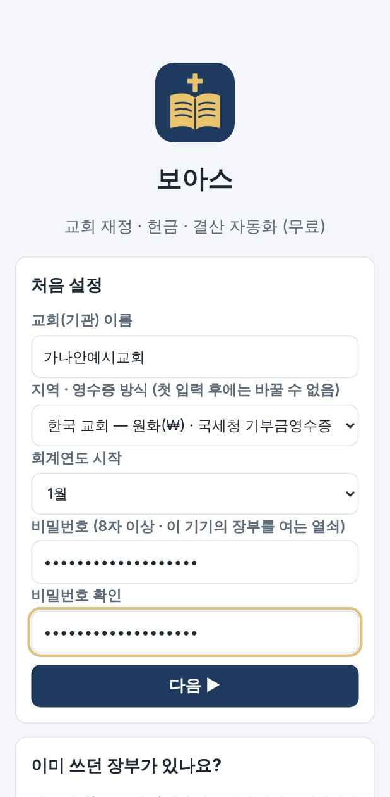
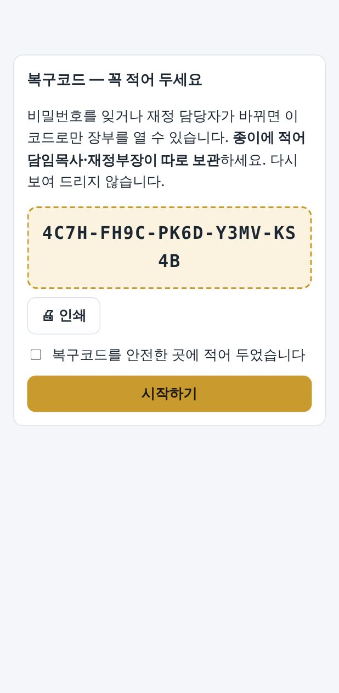

# 🚀 5분 빠른 시작 — 보아스 V1.0

> **보아스**는 교회(기관) 재정부를 위한 무료 앱입니다. 서버·회원가입이 없고, 모든 자료는 **이 기기 안에 암호화**되어 저장됩니다. 배포한 회사도 교회 자료를 볼 수 없습니다.

## 1. 앱 열기 · 설치 (1분)

배포사(또는 담당 목회자)가 알려 준 **앱 주소**를 엽니다.

| 기기 | 여는 브라우저 | 설치 방법 |
|---|---|---|
| 아이폰·아이패드 | **사파리** | 아래 공유 버튼(□↑) → **홈 화면에 추가** |
| 안드로이드 폰 | **크롬** | 오른쪽 위 ⋮ → **앱 설치** 또는 **홈 화면에 추가** |
| 윈도우·맥 PC | **크롬** 또는 **엣지** | 주소창 오른쪽 설치 아이콘(⊕) → **설치** |

설치하면 바탕화면이나 홈 화면에 **보아스 아이콘**이 생깁니다. 처음 연 뒤에는 **인터넷이 없어도** 동작합니다.

## 2. 처음 설정 (2분)



1. **교회(기관) 이름**을 입력합니다.
2. **지역·영수증 방식**을 고릅니다. 첫 거래를 입력한 뒤에는 바꿀 수 없습니다.
   - **한국 교회**: 원화(₩), 국세청 기부금영수증
   - **미국 이민교회**: 달러($), IRS 기준 Contribution Statement(헌금 영수증)
3. **회계연도 시작 월**을 고릅니다. 대부분 1월입니다.
4. **비밀번호**를 8자 이상으로 정합니다. 이 기기의 장부를 여는 열쇠입니다.

## 3. 복구코드 적어 두기 (1분) — 가장 중요



- 화면의 **복구코드**(예: `ABCD-EFGH-…`)를 **종이에 적어** 담임목사님과 재정부장님이 **각각 따로** 보관하세요.
- 비밀번호를 잊거나 재정 담당자가 바뀌었을 때 장부를 열 **유일한 방법**입니다.
- 다시 보여 주지 않습니다. 사진으로 찍어 단톡방에 올리지 마세요.

## 4. 첫 헌금 입력 (1분)

아래 메뉴에서 **🙏 헌금**을 누르고, 입력칸에 **한 줄에 한 건**씩 씁니다.

```
십일조 홍길동 10만
감사 성춘향 5만원
무명 3만 2천원
```

**미리보기 ▶** 로 확인한 뒤 **저장**을 누르면 끝입니다. 휴대폰에서는 키보드의 🎤(마이크)를 누르고 말로 불러도 됩니다.

## 5. 다음 할 일

- [ ] **설정**: 고유번호(미국은 EIN), 주소, 대표자 입력 → 영수증에 인쇄됩니다
- [ ] **교인**: 엑셀 명부를 복사해 붙여넣기 → 번호만 써도 이름 오타가 없어집니다
- [ ] **예산**: 올해 예산과 **전기 이월금**(지금 통장 잔액) 입력
- [ ] **설정 › 백업 파일 만들기** → 구글드라이브나 카카오톡 '나에게 보내기'에 보관

자세한 사용법은 [그림으로 보는 쉬운 사용설명서](02-쉬운사용설명서.md)를 보세요.
