# 📗 그림으로 보는 쉬운 사용설명서

> 재정 담당자(회계·재정부원)를 위한 설명서입니다. 화면 아래 메뉴 **홈 · 헌금 · 지출 · 보고서 · 더보기**만 기억하면 됩니다. PC에서는 왼쪽에 모든 메뉴가 보입니다.

---

## 1. 교인 명부 — 한 번만 등록

**더보기 › 👥 교인 › 엑셀 붙여넣기·CSV 가져오기**

1. 엑셀에서 교인 명부(번호·이름·주정·연락처)를 드래그해 **복사**(Ctrl+C)합니다.
2. 입력칸에 **붙여넣기**(Ctrl+V)하고 **다음**을 누릅니다.

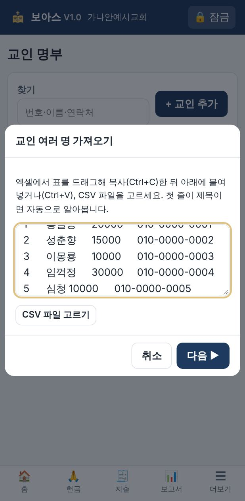

3. 각 열이 무엇인지 확인합니다. 첫 줄에 제목이 있으면 자동으로 맞춰집니다.

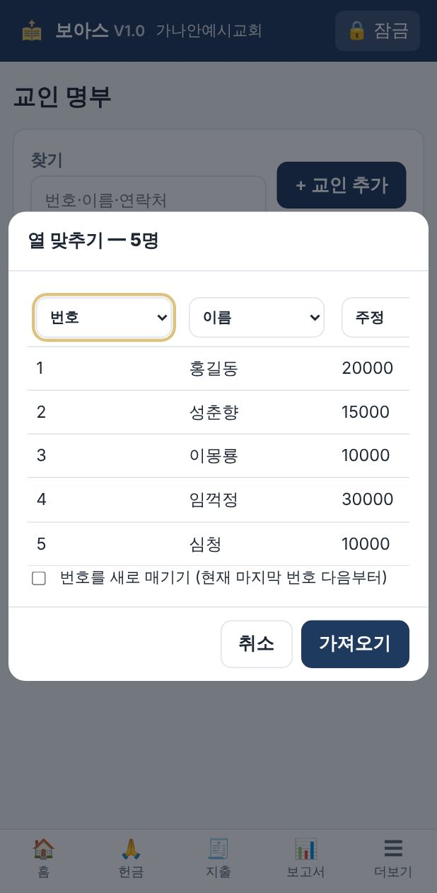

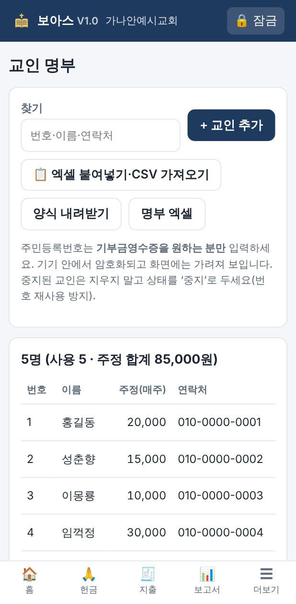

- **주정**은 매주 드리기로 약정한 금액입니다. 헌금 입력 때 **번호만 쓰면 이 금액이 자동으로** 들어갑니다.
- 교회를 떠난 분은 지우지 말고 **상태 → 중지**로 바꾸세요. 번호가 다른 분에게 다시 쓰이는 것을 막습니다.
- **한국 교회**: 주민등록번호는 기부금영수증을 원하는 분만 입력합니다. 암호화되어 저장되고 화면에는 `900101-1******`처럼 가려서 보입니다.
- **미국 이민교회**: SSN은 필요 없으므로 받지 않습니다. 영수증용 **주소**만 넣습니다.

---

## 2. 헌금 입력 — 매주 5분

**🙏 헌금**

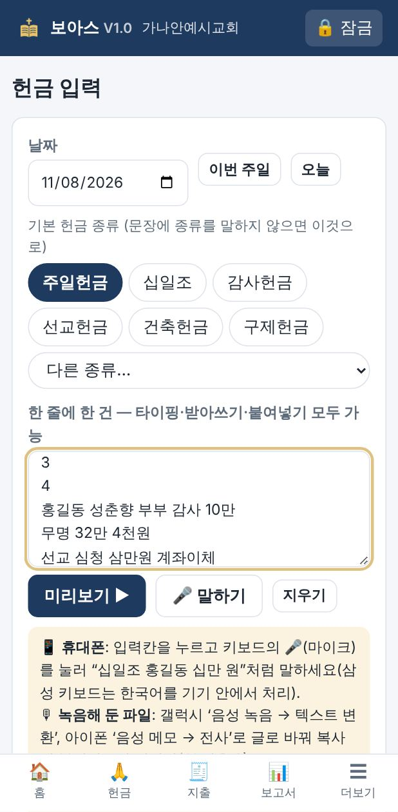

1. **날짜**를 확인합니다. '이번 주일' 버튼을 누르면 됩니다.
2. **기본 헌금 종류**를 고릅니다. 줄에 종류를 쓰지 않았을 때 이 종류로 들어갑니다.
3. 입력칸에 **한 줄에 한 건**씩 씁니다.

| 이렇게 쓰면 | 이렇게 들어갑니다 |
|---|---|
| `12 십일조 10만` | 교인 12번, 십일조, 100,000원 |
| `3` | 교인 3번, 주일헌금, **주정 금액 자동** |
| `홍길동 감사 5만원` | 홍길동, 감사헌금, 50,000원 |
| `홍길동 성춘향 부부 감사 10만` | 부부 공동 헌금 (성명2에 성춘향) |
| `무명 32만 4천원` | 무명, 324,000원 |
| `선교 이몽룡 삼만원 계좌이체` | 선교헌금, 30,000원, 결제: 계좌 |

**미국 이민교회**는 금액을 **달러**로 씁니다. **줄 맨 앞 숫자는 교인번호**, 그 뒤 숫자는 금액입니다.

| 이렇게 쓰면 | 이렇게 들어갑니다 |
|---|---|
| `12 십일조 150` | 교인 12번, 십일조, $150.00 |
| `#3 감사 $50.25 수표` | 교인 3번, 감사헌금, $50.25, 수표(Check) |
| `홍길동 선교 100불 zelle` | 선교헌금, $100.00, 온라인(Zelle) |

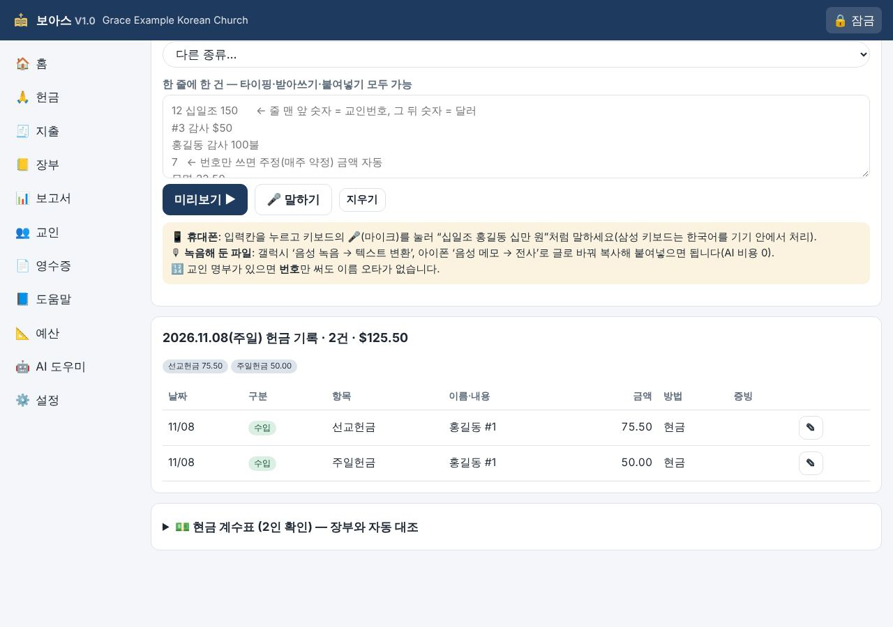

4. **미리보기 ▶** 를 누르면 표로 정리됩니다. 노란 줄(⚠)은 꼭 확인하세요.

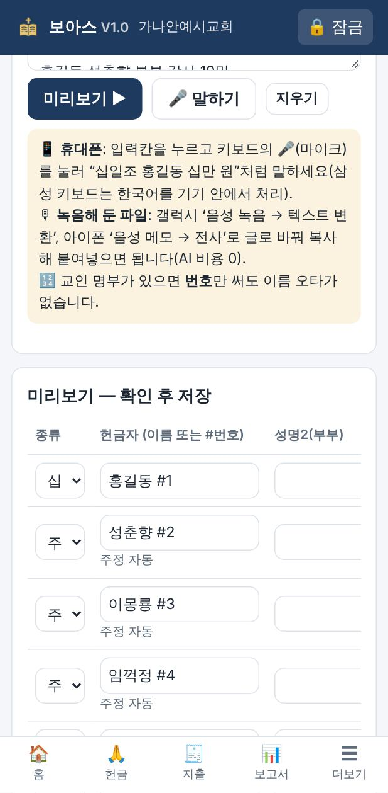

5. 표 안에서 바로 고칠 수 있습니다. 확인이 끝나면 **✔ 저장**을 누릅니다.

### 🎤 말로 입력하기
- **휴대폰**: 입력칸을 누르고 키보드의 **🎤**를 누른 뒤 "십일조 홍길동 십만 원"처럼 말합니다. 한 건 말하고 줄을 바꿉니다.
- **녹음해 둔 파일**: 갤럭시는 '음성 녹음' 앱의 **텍스트 변환**, 아이폰은 '음성 메모'의 **전사** 기능으로 글로 바꾼 뒤 복사해 붙여넣습니다. AI 비용이 들지 않습니다.
- **PC**: 윈도우는 **윈도우키 + H**로 받아쓰기를 켤 수 있습니다.

### 💵 현금 계수표 (두 사람이 함께)

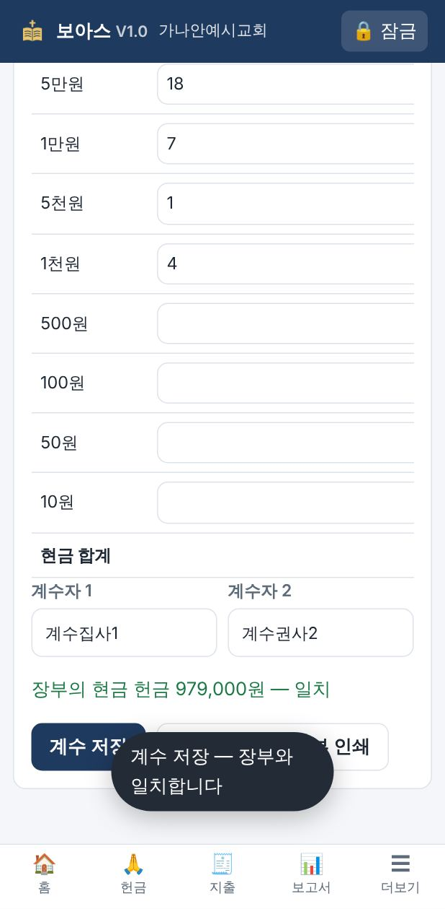

1. 헌금 화면 아래 **현금 계수표**를 엽니다.
2. 권종별 **매수**와 **계수자 2명**의 이름을 입력하고 **계수 저장**을 누릅니다.
3. 장부에 입력한 현금 합계와 **자동으로 비교**합니다. 차이가 나면 빨갛게 경고합니다.
4. **헌금 집계표 2부 인쇄**: 한 부는 계수자, 한 부는 회계가 보관합니다.

---

## 3. 지출 · 영수증 — 쓸 때마다 30초

**🧾 지출**

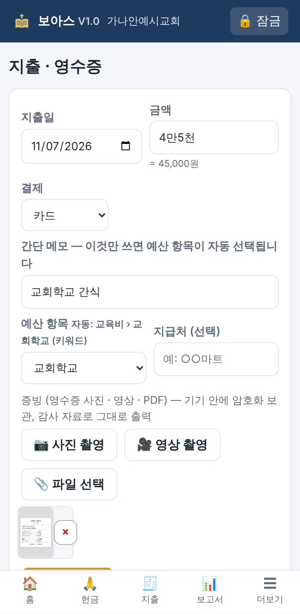

1. **금액**을 씁니다. `4만5천`처럼 써도 됩니다(미국은 `45.00`).
2. **간단 메모**를 씁니다(예: `교회학교 간식`, `승합차 주유`, `전기요금`). 메모를 쓰는 순간 **예산 항목이 자동으로 골라집니다**. 같은 메모를 여러 번 쓰면 그 교회 방식을 학습해 더 정확해집니다.
3. **📷 사진 촬영**으로 영수증을 찍습니다. **🎥 영상**이나 **📎 PDF**도 됩니다.
4. **✔ 지출 저장**을 누릅니다.

- 영수증이 없으면 **사유**를 꼭 남기게 되어 있습니다(예: 경조비 현금 전달). 감사 때 그대로 보입니다.
- 장부에서 해당 지출을 열어 **🖨 지출결의서**를 누르면 영수증 사진이 붙은 결의서가 인쇄됩니다.

---

## 4. 장부 — 찾기 · 고치기

**더보기 › 📒 장부**

- 기간, 수입/지출, 항목, 이름·메모로 찾습니다.
- 줄 오른쪽 **✎**를 누르면 고치거나 삭제할 수 있습니다. 삭제에는 사유가 필요하고, 모든 변경은 **감사로그**에 남습니다.
- 🔒 표시는 **마감된 기간**입니다. 고치려면 사유를 입력해야 합니다.

---

## 5. 보고서 · 결산 — 버튼 하나로

**📊 보고서**

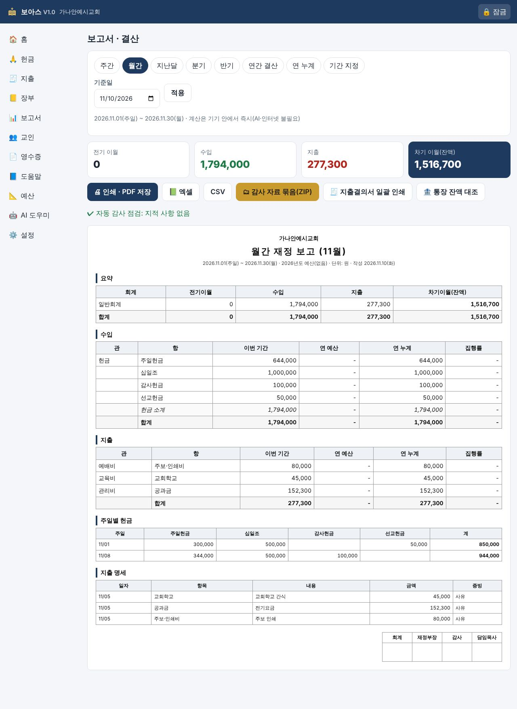

1. 기간을 고릅니다: **주간 · 월간 · 지난달 · 분기 · 반기 · 연간 결산 · 연 누계 · 기간 지정**
2. 화면에 바로 제직회 보고서가 만들어집니다. 전기 이월, 수입, 지출, 차기 이월, 예산 대비 집행률, 주일별 헌금, 지출 명세, 감사 점검이 들어갑니다.
3. 필요한 버튼을 누릅니다.

| 버튼 | 용도 |
|---|---|
| 🖨 인쇄 · PDF 저장 | 제직회·당회 보고, PDF로 단톡방 공유 |
| 📗 엑셀 / CSV | 노회·교단 제출, 추가 분석 |
| 🗂 감사 자료 묶음(ZIP) | 보고서, 지출결의서, 엑셀, 영수증 원본, 감사로그, 무결성 목록을 한 번에 |
| 🧾 지출결의서 일괄 인쇄 | 그 기간의 모든 지출결의서 |
| 🏦 통장 잔액 대조 | 통장 잔액을 입력하면 장부와의 차이를 보고서에 표시 |

> 💡 **자동 감사 점검**: 영수증 누락, 중복 의심, 고액 현금, 미분류 지출, 계수 불일치, 마감 후 수정 같은 것을 앱이 먼저 찾아서 알려 줍니다.

---

## 6. 예산 편성

**더보기 › 📐 예산**

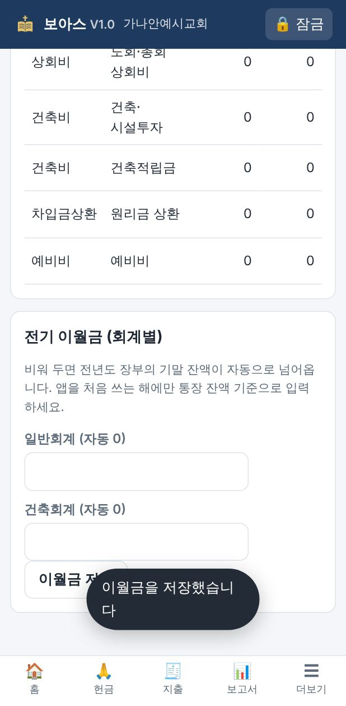

- **작년 예산 복사**, **작년 결산 금액으로**, **비율 조정 %** 버튼으로 초안을 빠르게 만듭니다.
- 공동의회·제직회를 통과하면 **확정**을 누릅니다. 확정한 뒤에는 실수로 바뀌지 않습니다. 추경할 때는 **확정 해제**를 누르고 사유를 남깁니다.
- **전기 이월금**은 앱을 처음 쓰는 해에만 통장 잔액을 기준으로 넣습니다. 그다음 해부터는 자동으로 넘어갑니다.

---

## 7. 기부금영수증 (한국) / Contribution Statement (미국)

**더보기 › 📄 영수증**

1. **귀속 연도**를 고릅니다. 세금은 1~12월 기준입니다.
2. 사람마다 **발급·인쇄**를 누르거나, **전체 발급·인쇄**를 누릅니다.
3. 일련번호는 중복 없이 자동으로 매겨집니다. 재발급하면 이전 번호는 무효로 대장에 남습니다.

| 한국 기부금영수증 | 미국 Contribution Statement |
|---|---|
| 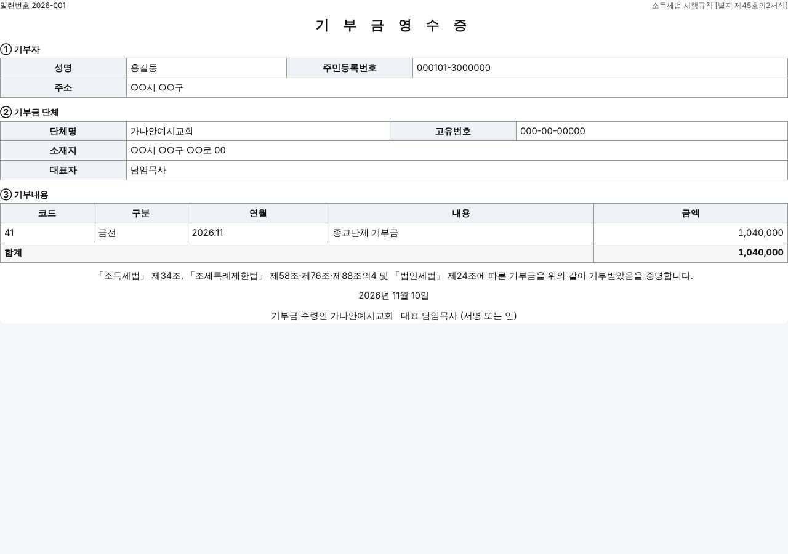 | 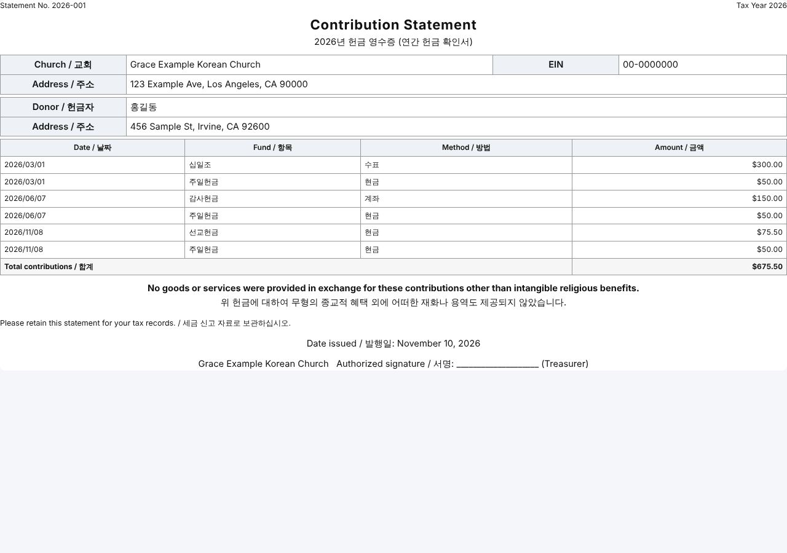 |

자세한 규정과 공식 링크는 [기부금영수증 가이드](04-영수증-가이드-한국-미국.md)를 보세요.

---

## 8. 사진 영수증을 AI로 한꺼번에 (선택)

**더보기 › 🤖 AI 도우미**

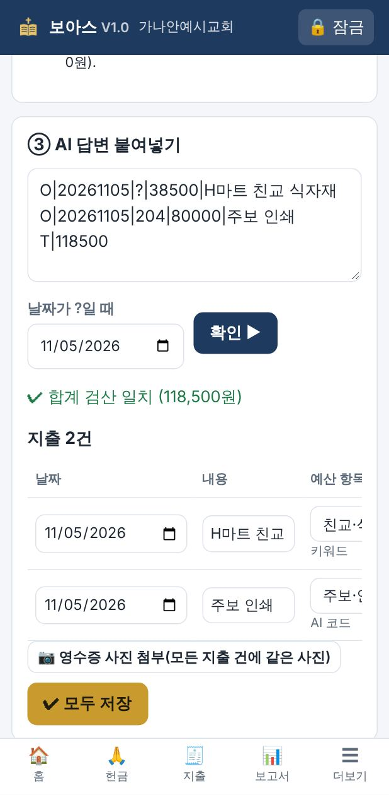

1. **지침 복사**를 눌러 무료 AI(Gemini·Claude·ChatGPT)에 **한 번만** 저장합니다.
2. 영수증 사진을 보내며 **"영수증"** 한 단어만 씁니다.
3. AI가 준 몇 줄을 그대로 **붙여넣고 확인 ▶ → 저장**합니다. 합계는 앱이 다시 검산합니다.

자세한 방법은 [무료 AI 활용 가이드](06-AI-활용-가이드.md)를 보세요.

---

## 9. 백업 · 다른 기기로 옮기기

**더보기 › ⚙️ 설정 › 백업**

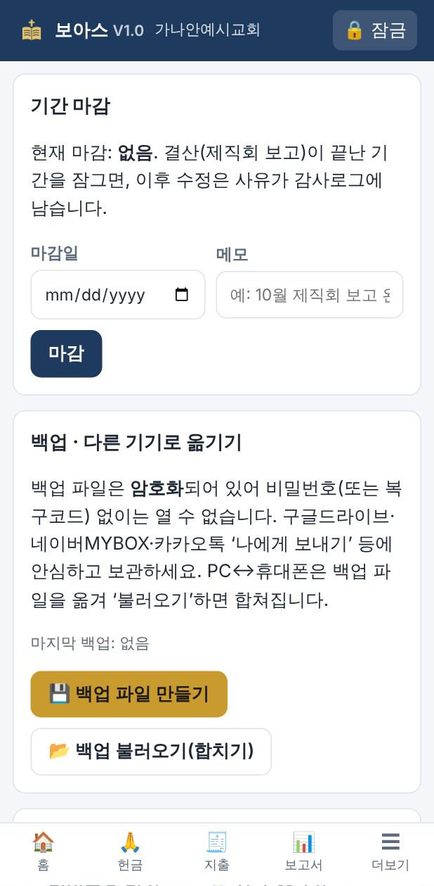

- **💾 백업 파일 만들기**: 암호화된 파일(`.boaz`)이 만들어집니다. 휴대폰에서는 공유 창이 떠서 카카오톡 '나에게 보내기'나 구글드라이브로 바로 보낼 수 있습니다.
- **📂 백업 불러오기(합치기)**: PC에서 만든 백업을 휴대폰에서 불러오면(또는 그 반대) **두 기기의 기록이 합쳐집니다**.
- 백업 파일은 비밀번호나 복구코드 없이는 열 수 없으므로 클라우드에 두어도 안전합니다.
- **2주에 한 번**, 그리고 **월 결산 직후**에는 반드시 백업하세요.

---

## 10. 홈 화면

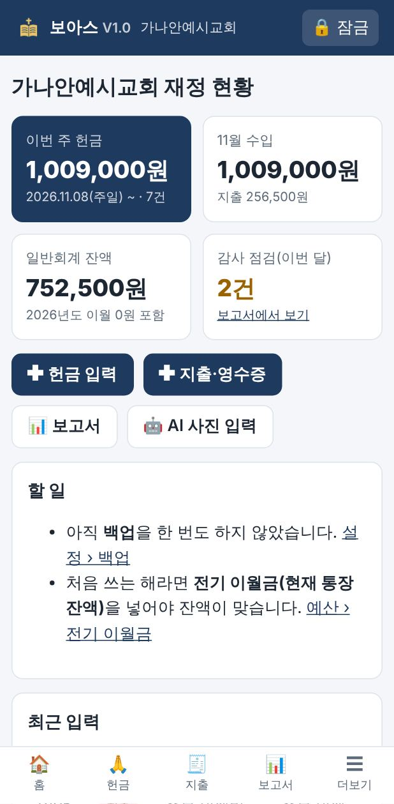

- 이번 주 헌금, 이번 달 수입·지출, 회계별 잔액, 감사 점검 건수를 한눈에 봅니다.
- **할 일**에 백업 시기, 지난달 마감, 예산·이월금 입력 같은 알림이 뜹니다.

---

## 11. 잠금

- 오른쪽 위 **🔒 잠금**을 누르면 바로 잠깁니다. 정해진 시간(기본 10분) 동안 쓰지 않아도 자동으로 잠깁니다.
- 비밀번호를 잊었으면 잠금 화면의 **복구코드로 열기**를 누르고 새 비밀번호를 정합니다.
